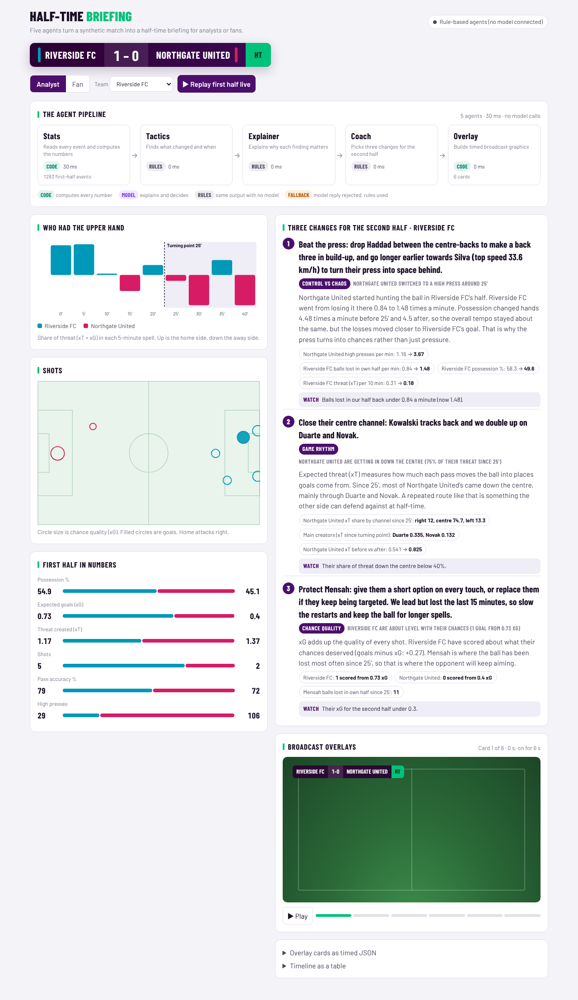

# Half-time Briefing

A multi-agent app that turns synthetic football events into an explained half-time briefing.
The same intelligence goes to two audiences:

- **Analyst mode**: three changes for the second half, each backed by evidence and a measurable target.
- **Fan mode**: a short story about your team and favourite player, in your language.

Built for the Microsoft x Premier League *Inside the Game* hackathon.



## How it maps to the hackathon brief

| Brief stage | What does it |
|---|---|
| Ingest | `halftime/generator.py` makes a seeded synthetic match (passes, shots, tackles, interceptions, pressures, fouls, sprints, possession changes). `/api/events` streams it, and the page can replay the half live. |
| Interpret | `halftime/metrics.py` computes possession, xG, expected threat (xT, Karun Singh's model, fitted on 40 simulated matches in `halftime/xt.py`), PPDA, high presses, pass difficulty, momentum, and the turning point of the half. |
| Explain | The tactics and explainer agents use these lenses: control vs chaos, pressure, game rhythm, chance quality. |
| Render | The overlay step outputs timed, machine-readable graphics cards (scorebug, stat bars, momentum, lower thirds). |
| Personalize | Analyst vs fan mode, team focus, favourite player, and language. |

## The agents

```
stats (code) -> tactics -> explainer -> coach | fan -> overlay (code)
```

- **Every number comes from code.** The model-backed agents only explain and decide, so they cannot invent a stat.
- **Model-backed agents run on Microsoft Agent Framework.** That's tactics, explainer, coach and fan. The tactics agent also gets the metric functions as tools.
- **Backend:** a model in Microsoft Foundry, configured in `.env` either keyless (`FOUNDRY_PROJECT_ENDPOINT` + `FOUNDRY_MODEL`, Entra ID sign-in) or with a key (`AZURE_OPENAI_ENDPOINT` + `AZURE_OPENAI_API_KEY` + `AZURE_OPENAI_DEPLOYMENT`). Plain OpenAI (`OPENAI_API_KEY`) also works.
- **No model configured:** each agent falls back to a rule-based version with the same output shape, so the demo always runs. The same fallback catches a model reply that can't be parsed.
- **MCP:** `halftime/mcp_server.py` exposes the same tools over MCP, so GitHub Copilot agent mode or a Foundry agent can query the match directly.

## Run it

```bash
pip install -r requirements-dev.txt
uvicorn app:app --reload          # http://localhost:8000
python -m pytest -q               # 10 tests
python -m halftime.mcp_server     # MCP server over stdio
```

To connect a model in Microsoft Foundry, copy `.env.example` to `.env` and fill in one of the two options. `.env` is git-ignored and kept out of the Docker image.

- **Key-based:** your deployment's endpoint, API key and deployment name.
- **Keyless:** your project endpoint and deployment name, signed in with `az login`.

The page header shows which backend is active.

## Deploy to Azure Container Apps

The app ships as one container (`Dockerfile`). CI builds it and smoke-tests it on every pull request.

```bash
az login
az group create -n rg-insidethegame -l eastus
az containerapp up -n halftime-briefing -g rg-insidethegame -l eastus \
  --source . --ingress external --target-port 8000 \
  --env-vars FOUNDRY_PROJECT_ENDPOINT=<endpoint> FOUNDRY_MODEL=<deployment>
```

The app signs in to Foundry with `DefaultAzureCredential`, so in Azure it uses the container app's managed identity. No keys are stored. Give that identity the **Foundry User** role (formerly Azure AI User). Use the role ID, because Microsoft recommends the ID while the role rename rolls out:

```bash
az containerapp identity assign -n halftime-briefing -g rg-insidethegame --system-assigned
az role assignment create --assignee <principalId from the previous command> \
  --role 53ca6127-db72-4b80-b1b0-d745d6d5456d --scope <Foundry resource id>
```

Without the two `FOUNDRY_*` variables, the deployed app still works using the rule-based agents.

## Status and limits

- Tested offline: rule-based agents, the API, the page at desktop and phone width, and the Agent Framework wiring (using a scripted stand-in model).
- The Foundry path has **not** yet been run against a live endpoint.
- Offline fan mode writes English only. Other languages need a model.
- The synthetic data has more turnovers than a real match, which makes PPDA run low. The demo match is seed 27: the home side leads 1-0, but the away side switches to a high press at 25' and takes over.
